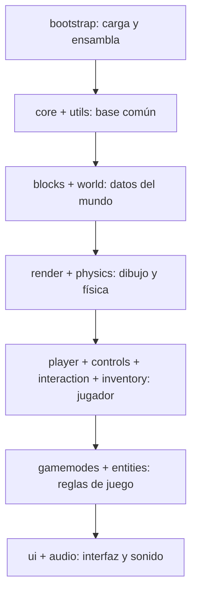

# js

## Descripción y objetivo
Código fuente del juego, dividido en 15 carpetas por responsabilidad. No hay `import`/`export` ni bundler. Cada archivo se registra en `window.MineKhanParts` y [`bootstrap`](bootstrap/README_bootstrap.md) los fusiona en una única función `MineKhan()`, por lo que todos los módulos comparten el mismo ámbito de variables.

Cada subcarpeta tiene su propio README con sus archivos, dependencias y relaciones. Conviene consultar primero el README del módulo antes de modificar o analizar cualquiera de sus archivos.

## Carpetas
| Carpeta | Qué contiene | README |
|---|---|---|
| `bootstrap/` | Arranque: `index.html`, cargador por dependencias, manifiesto de módulos y ensamblador. | [bootstrap](bootstrap/README_bootstrap.md) |
| `core/` | Entorno DOM, constantes, ajustes, estado global, bus de eventos `hooks`, métricas, inicialización y bucle principal. | [core](core/README_core.md) |
| `utils/` | Vectores, formato numérico, azar con semilla y ruido (Perlin y OpenSimplex). | [utils](utils/README_utils.md) |
| `blocks/` | Registro y definición de bloques, propiedades de rotura y texturas procedurales con su atlas WebGL. | [blocks](blocks/README_blocks.md) |
| `world/` | Mundo, chunks y secciones, sombras, colas de carga, generación procedural y guardado (IndexedDB). | [world](world/README_world.md) |
| `render/` | WebGL, shaders, matrices, cámara, geometría e iconos de bloques, helpers 2D y fondos de menú. | [render](render/README_render.md) |
| `physics/` | Gravedad, colisiones AABB, integración del movimiento y raycast del bloque apuntado. | [physics](physics/README_physics.md) |
| `player/` | Estado del jugador, modos (vuelo, sneak, zoom, espectador), punto de aparición e inicialización. | [player](player/README_player.md) |
| `controls/` | Teclado, ratón, rueda, eventos de ventana, bloqueo de puntero y entrada de movimiento. | [controls](controls/README_controls.md) |
| `interaction/` | Romper y colocar bloques en el mundo. | [interaction](interaction/README_interaction.md) |
| `inventory/` | Estado del inventario, hotbar, pilas de objetos e inventario creativo. | [inventory](inventory/README_inventory.md) |
| `gamemodes/` | Gestor de modos de juego, modo Creativo y modo Supervivencia (`survival/`). | [gamemodes](gamemodes/README_gamemodes.md) |
| `entities/` | Entidad base, gestor de entidades e ítems caídos. | [entities](entities/README_entities.md) |
| `ui/` | Gestor de escenas, widgets, pantallas de menú y HUD. | [ui](ui/README_ui.md) |
| `audio/` | Sonido sintetizado con WebAudio y su conexión con los eventos del juego. | [audio](audio/README_audio.md) |

## Capas y flujo
Las carpetas se pueden leer por capas: cada una usa las de las capas anteriores.

Este es un esquema orientativo. El orden real de carga está en `bootstrap/module-manifest.js` (por `requires`) y el de ejecución, en el campo `order` de cada parte.

## Dónde mirar según la tarea
| Si quieres… | Empieza por |
|---|---|
| Entender cómo arranca el juego o añadir un archivo nuevo | [bootstrap](bootstrap/README_bootstrap.md) |
| Cambiar ajustes, estado global o el bucle principal | [core](core/README_core.md) |
| Añadir o modificar un bloque o su textura | [blocks](blocks/README_blocks.md) |
| Cambiar la generación del terreno, cuevas o árboles | [world](world/README_world.md) |
| Tocar el dibujado, shaders o cámara | [render](render/README_render.md) |
| Ajustar gravedad, colisiones o el bloque apuntado | [physics](physics/README_physics.md) |
| Cambiar teclas, ratón o la entrada de movimiento | [controls](controls/README_controls.md) |
| Modificar cómo se rompen o colocan bloques | [interaction](interaction/README_interaction.md) |
| Cambiar la hotbar o el inventario | [inventory](inventory/README_inventory.md) |
| Editar reglas de Creativo o Supervivencia | [gamemodes](gamemodes/README_gamemodes.md) |
| Añadir entidades o ítems caídos | [entities](entities/README_entities.md) |
| Modificar menús, pantallas o HUD | [ui](ui/README_ui.md) |
| Cambiar o añadir sonidos | [audio](audio/README_audio.md) |
| Usar ruido, vectores o azar con semilla | [utils](utils/README_utils.md) |
| Cambiar estado del jugador, modos o aparición | [player](player/README_player.md) |

## Referencias
- Punto de entrada del proyecto: [`Launcher.html`](../Launcher.html).
- Herramientas de desarrollo: [`dev/`](../dev/).
- Documentación general: [`docs/README.md`](../docs/README.md).