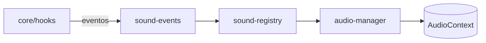

# audio

## Descripción y objetivo
Sonido del juego mediante síntesis procedural con WebAudio. No usa archivos de audio: los efectos se generan por código. Se conecta al resto del juego a través del bus de eventos `hooks`.

## Archivos
| Archivo | Provee | Función |
|---|---|---|
| `audio-manager.js` | `audioManager` | Motor WebAudio: instancia de `AudioContext` e interfaz de reproducción y volumen. |
| `sound-registry.js` | `soundRegistry` | Registro de "recetas" de sonido sintético (generadores de efectos). |
| `sound-events.js` | — | Suscribe eventos de `hooks` a la reproducción de sonidos. |

## Flujo

## Dependencias
- `audio-manager` → `core/environment`
- `sound-registry` → `audio-manager`
- `sound-events` → `sound-registry`, `core/hooks`

## Referencias
- [`core`](../core/README_core.md): `hooks` y `environment`.
- Orden de ensamblado: 30.50 a 30.52 (después de los controles).