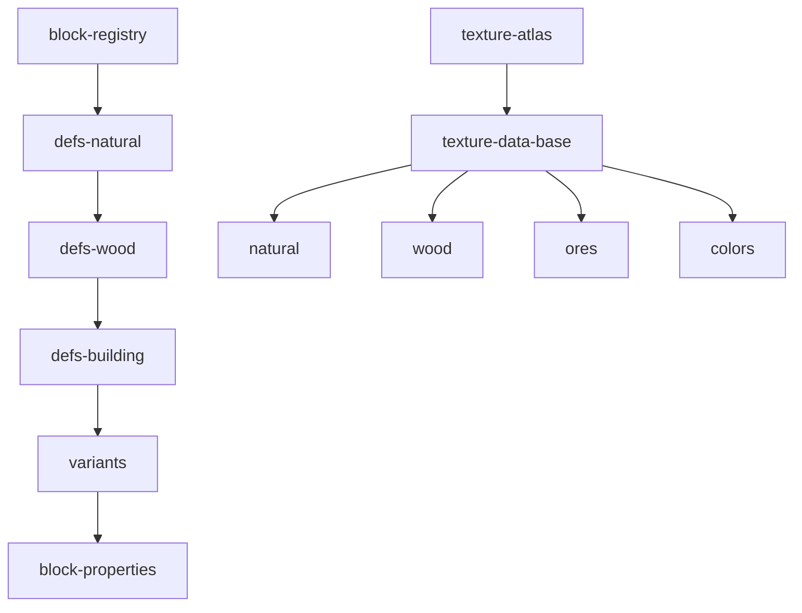

# blocks

## Descripción y objetivo
Define qué bloques existen, sus propiedades y sus texturas. Las texturas se generan por código (píxeles procedurales) y se empaquetan en un atlas WebGL.

## Archivos: registro y definiciones
| Archivo | Provee | Función |
|---|---|---|
| `block-registry.js` | `blockData`, `blockIds`, `BLOCK_COUNT` | Registro central de bloques, normalización y mapa de IDs. |
| `block-defs-natural.js` | — | Bloques 1–27 (naturales, tierras, minerales). |
| `block-defs-wood.js` | — | Bloques 28–39 (madera, tablones, troncos). |
| `block-defs-building.js` | — | Bloques 40–94 (construcción, lanas, hormigón, piedras). |
| `block-variants.js` | — | Bloques 95–108 (variantes y especiales). |
| `block-properties.js` | `blockName`, `blockBreakTimes`, `breakTime` | Tabla de dureza y tiempos de rotura. |

## Archivos: texturas
| Archivo | Provee | Función |
|---|---|---|
| `texture-atlas.js` | `setPixel`, `getPixels`, `initTextures` | Punteros de píxeles y creación del atlas WebGL. |
| `texture-data-base.js` | `textures` | Objeto `textures` y texturas base (hierba, hojas, tablones de roble, hitbox). |
| `texture-data-natural.js` | — | Texturas de bloques naturales (según nombre y manifiesto). |
| `texture-data-wood.js` | — | Texturas de madera (según nombre y manifiesto). |
| `texture-data-ores.js` | — | Texturas de minerales (según nombre y manifiesto). |
| `texture-data-colors.js` | — | Texturas de colores (según nombre y manifiesto). |

## Flujo

## Dependencias
- Las definiciones se encadenan en el manifiesto: `registry → natural → wood → building → variants → properties`.
- Todos los `texture-data-*` dependen de `texture-data-base`, que depende de `texture-atlas`.
- Dependen de `core/environment`.

## Referencias
- Consumen `blockData`/`blockIds`: [`world`](../world/README_world.md), [`physics`](../physics/README_physics.md), [`interaction`](../interaction/README_interaction.md), [`render`](../render/README_render.md), [`gamemodes`](../gamemodes/README_gamemodes.md).
- `initTextures` usa `gl` de [`render`](../render/README_render.md).