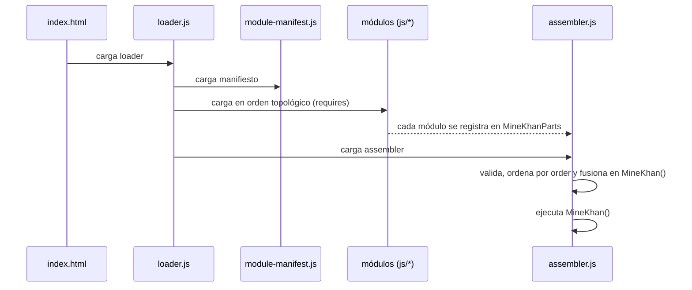

# bootstrap

## Descripción y objetivo
Arranque del juego. Carga los módulos en el orden correcto, los fusiona en una sola función `MineKhan()` y la ejecuta.

## Archivos
| Archivo | Función |
|---|---|
| `index.html` | Página del juego: `<canvas id="overlay">`, campos auxiliares ocultos (guardado, mensajes), shaders GLSL en etiquetas `<script>` y carga de `loader.js`. Usa `<base href="../../">`. |
| `loader.js` | Carga `module-manifest.js`, ordena los módulos por `requires` (orden topológico) y los inyecta como `<script>` en secuencia. Falla si hay dependencia circular o módulo no encontrado. Al terminar carga `assembler.js`. |
| `module-manifest.js` | Define `window.MineKhanManifest`: lista de `{ id, file, requires }` de todos los módulos. |
| `assembler.js` | Ordena `window.MineKhanParts` por `order`, valida duplicados de `id`/`order` y cobertura de las secciones base 1–40, concatena los `body` en `function MineKhan()` y la ejecuta (`init = MineKhan(); init()`). |

## Flujo

## Notas técnicas
- El orden de carga (por `requires`) no es el orden de ejecución dentro de `MineKhan()` (por `order`).
- El `id` del manifiesto y el `id` interno de cada parte pueden diferir (p. ej. `blocks/block-registry` vs `blocks/registry-init`).

## Dependencias
- Referencia a todos los módulos de `js/` a través del manifiesto.

## Referencias
- Punto de entrada del proyecto: `Launcher.html` (raíz). Prueba de módulos: `dev/check-modules.js`.