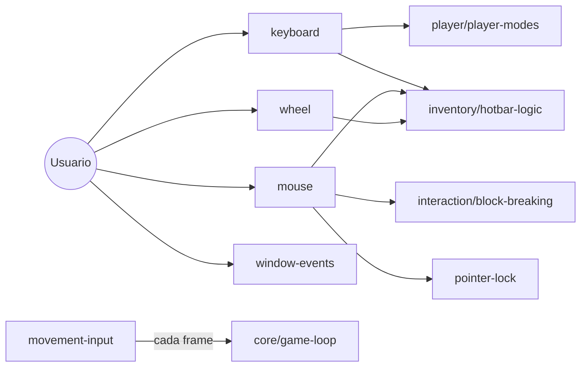

# controls

## Descripción y objetivo
Captura la entrada del usuario (teclado, ratón, rueda, ventana y bloqueo de puntero) y la traduce en acciones del juego.

## Archivos
| Archivo | Provee | Función |
|---|---|---|
| `key-bindings.js` | `KEY_MAP` | Mapa de teclas a acciones. |
| `keyboard.js` | `canvas.onkeydown`, `canvas.onkeyup` | Eventos de teclado: modos del jugador, hotbar, comer, pausa. |
| `mouse.js` | `unpauseDelay`, `mmoved`, `trackMouse`, `canvas.onmousedown/up`, `oncontextmenu`, `onpointerlockchange` | Cámara, clics, romper/colocar bloques, pick-block, menús. |
| `wheel.js` | `canvas.onwheel`, `document.onwheel` | Rueda del ratón para desplazar la hotbar. |
| `pointer-lock.js` | `getPointer`, `releasePointer` | Pointer Lock API. |
| `movement-input.js` | `controls` | Convierte teclas en desplazamiento y rotación cada frame. |
| `window-events.js` | `canvas.onblur`, `window.onbeforeunload`, `window.onresize` | Pérdida de foco, cierre y redimensionado. |

## Flujo

## Dependencias
- `keyboard` → `key-bindings`, `player-modes`, `hotbar-logic`.
- `mouse` → `pointer-lock`, `hotbar-logic`, `block-breaking`.
- `wheel` → `hotbar-logic`. `movement-input` → `player-state`, `core/settings`.
- `pointer-lock` y `window-events` → `core/environment`.

## Referencias
- [`player`](../player/README_player.md), [`inventory`](../inventory/README_inventory.md), [`interaction`](../interaction/README_interaction.md), [`ui`](../ui/README_ui.md) (`changeScene`, `drawScreens`), [`core`](../core/README_core.md).