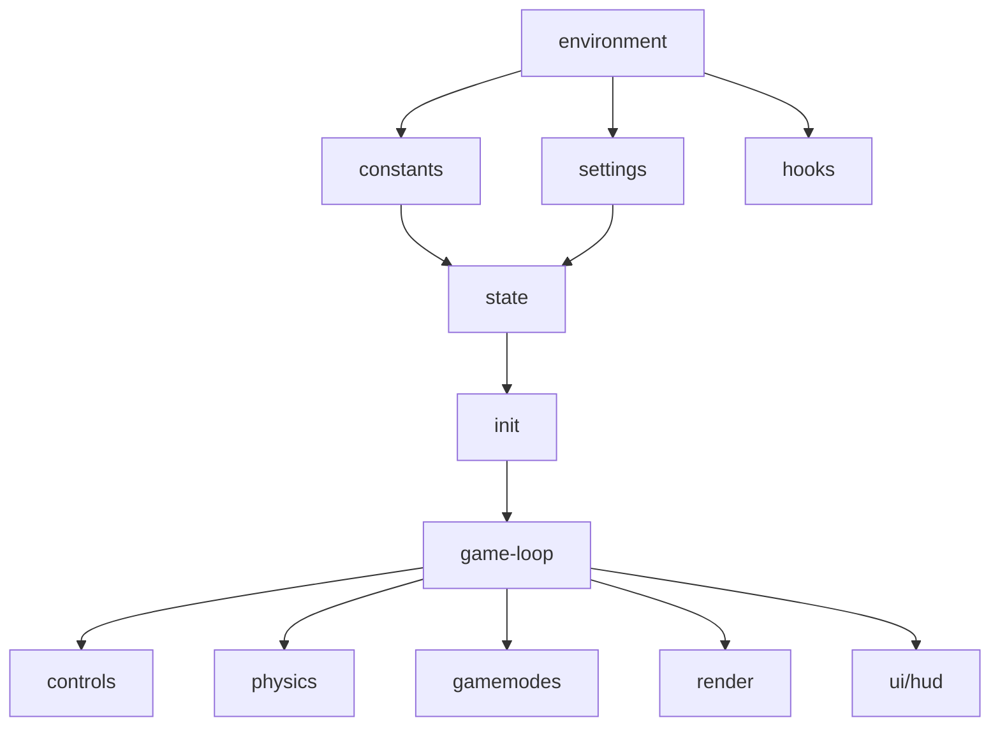

# core

## Descripción y objetivo
Núcleo del juego: entorno DOM, constantes, ajustes, estado global, bus de eventos, métricas, inicialización y bucle principal.

## Archivos
| Archivo | Provee | Función |
|---|---|---|
| `environment.js` | `canvas`, `ctx`, `win`, `doc`, `world`, `worlds`, `MathGlob`, `MineKhanParts`… | Referencias al DOM (`overlay`, `savebox`…) y globales iniciales. |
| `constants.js` | `CUBE`, `SLAB`, `STAIR`, `FLIP`, `NORTH`/`SOUTH`/`EAST`/`WEST`, `ROTATION`, `Block`, `Sides` | Constantes de geometría y caras. |
| `settings.js` | `settings` | Ajustes (`renderDistance`, `fov`, `mouseSense`). |
| `state.js` | `version`, `reach`, `sky`, `superflat`, `trees`, `caves`, `generator`, `maxHeight`, `textureMap`, `mainbg`… | Estado global y parámetros de generación. |
| `hooks.js` | `hooks` | Bus de eventos con `on(evento, callback)` y `emit(evento, datos)`. |
| `analytics.js` | `analytics` | Contadores de rendimiento y FPS. |
| `init.js` | `initEverything` | Inicialización global (semilla, ruido, jugador, WebGL, fondos, botones). |
| `game-loop.js` | `drawScreens.play`, `gameLoop` | Pantalla de juego y bucle principal. |

## Flujo

## Dependencias
- `constants`, `settings`, `hooks`, `analytics` → `environment`.
- `state` → `constants`, `settings`. `init` → `state`. `game-loop` → `init`.

## Referencias
- `game-loop` usa `controls`, `runGravity`, `resolveContactsAndUpdatePosition`, `hud`, `defineWorld`: ver [`controls`](README_controls.md), [`physics`](README_physics.md), [`ui`](README_ui.md), [`render`](README_render.md).
- `hooks` lo usan [`audio`](README_audio.md), [`entities`](README_entities.md) y [`gamemodes`](README_gamemodes.md).