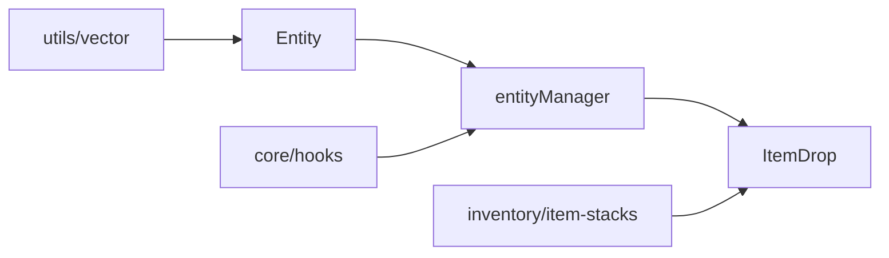

# entities

## Descripción y objetivo
Base para entidades del mundo y su gestión. La única entidad concreta presente es el ítem soltado (`ItemDrop`).

## Archivos
| Archivo | Provee | Función |
|---|---|---|
| `entity-base.js` | `Entity` | Clase base: propiedades cinemáticas (usa `PVector`) y ciclo de vida. |
| `entity-manager.js` | `entityManager` | Lista de entidades activas y bucle de actualización; usa `hooks`. |
| `item-drops.js` | `ItemDrop` | Ítem caído: recogida (`survivalAdd`) y animación. |

## Flujo

## Dependencias
- `entity-base` → `utils/vector`. `entity-manager` → `entity-base`, `core/hooks`.
- `item-drops` → `entity-manager`, `inventory/item-stacks`.

## Referencias
- [`utils`](../utils/README_utils.md), [`core`](../core/README_core.md), [`inventory`](../inventory/README_inventory.md).