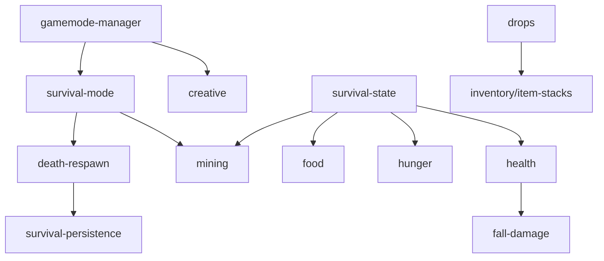

# gamemodes

## Descripción y objetivo
Modos de juego bajo un gestor común: Creativo y Supervivencia. Cada modo se registra con `registerGamemode`.

## Archivos
| Archivo | Provee | Función |
|---|---|---|
| `gamemode-manager.js` | `gamemodes`, `currentGamemode`, `registerGamemode`, `setGamemode` | Registro de modos y despacho de su ciclo de vida. |
| `creative.js` | `creativeGamemode` | Bloques ilimitados y vuelo; usa `hooks`. |
| `survival/` | — | Modo Supervivencia (ver abajo). |

## Subcarpeta `survival/`
| Archivo | Provee | Función |
|---|---|---|
| `survival-state.js` | `gameMode`, `newGameMode`, `savedCreativeHotbar`, `SURVIVAL_REACH`, `survival` | Estado y constantes. |
| `health.js` | `survivalHurt`, `survivalHealthTick` | Daño, regeneración e inanición. |
| `hunger.js` | `survivalEat`, `survivalHungerTick` | Hambre, saturación y agotamiento. |
| `food.js` | `survivalEat` | Consumo de alimentos (manzanas). |
| `fall-damage.js` | `survivalFallTick` | Daño por caída y vacío. |
| `mining.js` | `survivalMine` | Minado continuo con progreso. |
| `drops.js` | `survivalOnBroken` | Recompensas al romper bloques. |
| `death-respawn.js` | `survivalDie`, `survivalRespawn` | Muerte y reaparición. |
| `survival-persistence.js` | `survivalKey`, `survivalSave`, `survivalForget`, `survivalInit`, `survivalLoad` | Guardado en `localStorage`. |
| `survival-mode.js` | `survivalGamemode`, `survivalTick` | Definición del modo y su tick. |
| `_legacy-survival.js` | `survivalTick`, `survivalDie`, `survivalRespawn`, `survivalSave`… | Versión legacy agrupada (tick, muerte, persistencia); sigue en el manifiesto y la usa `ui/hud/_legacy-survival-hud.js`. |

## Flujo

## Dependencias
- `gamemode-manager` → `core/environment`. `creative` → `gamemode-manager`, `core/hooks`.
- `mining` y `drops` → `blocks/block-properties`. `drops`, `survival-persistence` → `inventory/item-stacks`.
- `hunger` → `player/player-state`.

## Referencias
- [`blocks`](README_blocks.md), [`inventory`](README_inventory.md), [`player`](README_player.md), [`ui`](README_ui.md) (HUD y pantalla de muerte), [`core`](README_core.md).