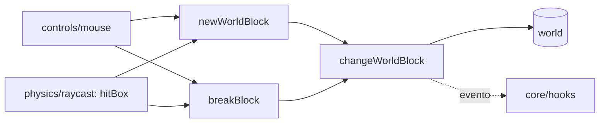

# interaction

## Descripción y objetivo
Modificación de bloques por el jugador: romper y colocar.

## Archivos
| Archivo | Provee | Función |
|---|---|---|
| `block-breaking.js` | `changeWorldBlock`, `breakBlock` | Función central para cambiar un bloque del mundo (rotación, caras invertidas); rotura y emisión de eventos vía `hooks`. |
| `block-placing.js` | `newWorldBlock` | Calcula la posición según la cara apuntada y coloca el bloque. |

## Flujo

## Dependencias
- `block-breaking` → `core/constants`, `blocks/block-registry`.
- `block-placing` → `block-breaking`, `physics/collision` (`inBox`).
- Usan en tiempo de ejecución `hitBox`, `holding`, `currentGamemode`, `world`.

## Referencias
- [`physics`](README_physics.md) (raycast y colisión), [`controls`](README_controls.md), [`world`](README_world.md), [`gamemodes`](README_gamemodes.md).