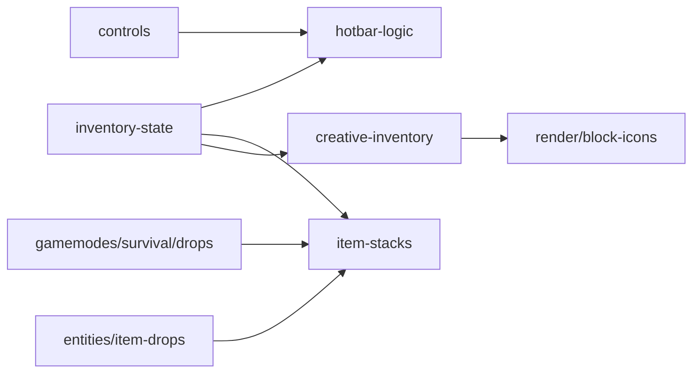

# inventory

## Descripción y objetivo
Estado del inventario, selección de la hotbar, pilas de objetos y pantalla del inventario creativo.

## Archivos
| Archivo | Provee | Función |
|---|---|---|
| `inventory-state.js` | `inventory` | Estructura del inventario: `hotbar`, `main` y ranuras. |
| `hotbar-logic.js` | `selectHotbarSlot`, `pickBlock`, `scrollHotbar` | Selección de ranura, pick-block y scroll. |
| `item-stacks.js` | `survivalAdd`, `survivalConsume`, `survivalSyncHotbar` | Alta, consumo y sincronización de pilas. |
| `creative-inventory.js` | `drawInv`, `clickInv` | Dibujo e interacción del inventario creativo. |

## Flujo

## Dependencias
- `inventory-state` → `player/player-state`. `hotbar-logic` → `inventory-state`.
- `creative-inventory` → `inventory-state`, `render/block-icons`.
- `item-stacks` → `gamemodes/survival/survival-state`, `inventory-state`.

## Referencias
- [`player`](README_player.md), [`render`](README_render.md), [`controls`](README_controls.md), [`gamemodes`](README_gamemodes.md), [`entities`](README_entities.md), [`ui`](README_ui.md).