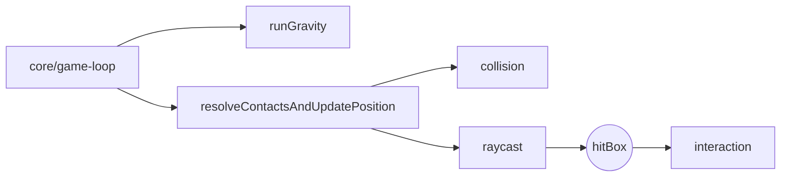

# physics

## Descripción y objetivo
Física del jugador y detección del bloque apuntado: gravedad, colisiones AABB, integración del movimiento y raycast.

## Archivos
| Archivo | Provee | Función |
|---|---|---|
| `gravity.js` | `runGravity` | Gravedad vertical, impulso de salto y velocidad límite. |
| `collision.js` | `inBox`, `onBox`, `collided`, `contacts` | Intersección de cajas AABB y lista de contactos. |
| `movement.js` | `resolveContactsAndUpdatePosition` | Resolución de contactos, fricción, escalón y actualización de posición. |
| `raycast.js` | `rayTrace`, `runRayTrace`, `lookingAt` | Trazado de rayos contra la forma de los bloques para hallar el bloque y la cara apuntados. |

## Flujo

## Dependencias
- `raycast` → `core/environment`, `blocks/block-registry`.
- `collision` → `core/environment`, `utils/format` (`roundBits`), `blocks/block-registry`.
- `movement` → `collision`, `raycast`. `gravity` → `core/environment`.

## Referencias
- [`core`](../core/README_core.md), [`blocks`](../blocks/README_blocks.md), [`interaction`](../interaction/README_interaction.md), [`player`](../player/README_player.md).