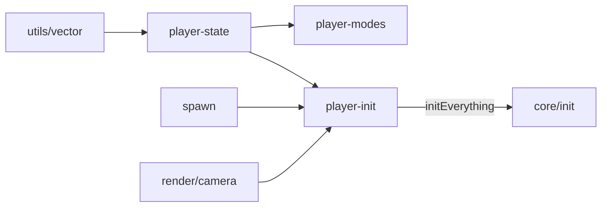

# player

## Descripción y objetivo
Estado y configuración del jugador: posición, vectores de cámara, modos (vuelo, sneak, zoom, espectador) y punto de aparición.

## Archivos
| Archivo | Provee | Función |
|---|---|---|
| `player-state.js` | `p`, `p2`, `hitBox`, `holding`, `Key`, `modelView`, `glCache`, `worlds`, `selectedWorld`, `freezeFrame`, `vec1–3`, `move`, `place` | Variables de estado del jugador, cámara y entrada. |
| `player-modes.js` | `toggleBlockMode`, `toggleAutoBreak`, `toggleFlight`, `setZoom`, `setSneaking`, `toggleSpectator` | Conmutadores de modo. |
| `spawn.js` | `getSpawnY` | Altura de aparición inicial según el generador. |
| `player-init.js` | `initPlayer` | Inicializa propiedades y físicas del jugador (usa `Camera`, `PVector`, `getSpawnY`). |

## Flujo

## Dependencias
- `player-state` → `core/environment`, `utils/vector`.
- `spawn` → `core/state`, `utils/perlin-noise`.
- `player-init` → `player-state`, `render/camera`, `spawn`.
- `player-modes` → `player-state`, `core/constants`, `core/settings`.

## Referencias
- [`utils`](../utils/README_utils.md), [`render`](../render/README_render.md), [`core`](../core/README_core.md), [`controls`](../controls/README_controls.md), [`inventory`](../inventory/README_inventory.md).