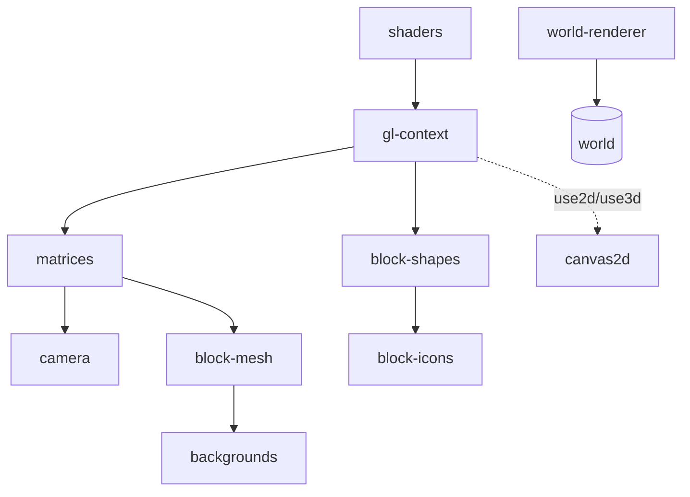

# render

## Descripción y objetivo
Todo el dibujado: contexto WebGL y shaders para el mundo 3D, helpers de canvas 2D, matrices, cámara, geometría de bloques e iconos, y fondos de menú.

## Archivos
| Archivo | Provee | Función |
|---|---|---|
| `shaders.js` | `program3D`, `program2D`, `createProgramObject`, fuentes GLSL | Código GLSL y compilación de programas. |
| `gl-context.js` | `gl`, `use2d`, `use3d`, `initWebgl` | Contexto WebGL y conmutación 2D/3D. |
| `canvas2d.js` | `fill`, `stroke`, `line`, `text`, `textSize`, `strokeWeight`, `cursor`… | Helpers de dibujo sobre el canvas 2D. |
| `matrices.js` | `Matrix`, `uniformMatrix`, `trans`, `rotX`, `rotY`, `matMult`, `FOV`, `initModelView`… | Álgebra matricial 3D y proyección. |
| `camera.js` | `Plane`, `defaultTransformation`, `Camera` | Planos de recorte y cámara. |
| `block-shapes.js` | `shapes`, `initShapes`, `objectify`, `compareArr` | Geometría de cubo, losa, escalera y variantes. |
| `block-mesh.js` | `box2`, `block2` | Dibujo inmediato de bloques para interfaz y menús. |
| `block-icons.js` | `genIcons`, `blockIcons`, `indexOrder`, vértices de iconos | Iconos de bloques para inventario y hotbar. |
| `backgrounds.js` | `initBackgrounds` | Fondos procedurales de menús (incluido el fondo de tierra 2D). |
| `world-renderer.js` | `defineWorld` | Actualiza y renderiza el mundo. |

## Flujo

## Dependencias
- `gl-context` → `core/environment`, `render/shaders`.
- `block-shapes` → `gl-context`, `core/constants`. `matrices` → `gl-context`.
- `camera` → `matrices`, `core/settings`, `core/state`.
- `block-mesh` → `gl-context`, `matrices`, `core/constants`. `backgrounds` → `gl-context`, `block-mesh`.
- `block-icons` → `gl-context`, `block-shapes`, `matrices`. `world-renderer` → `core/state`.

## Referencias
- [`blocks`](README_blocks.md) (`blockData`, atlas), [`world`](README_world.md), [`ui`](README_ui.md), [`core`](README_core.md).
- Los shaders también aparecen como etiquetas `<script>` en `bootstrap/index.html`.