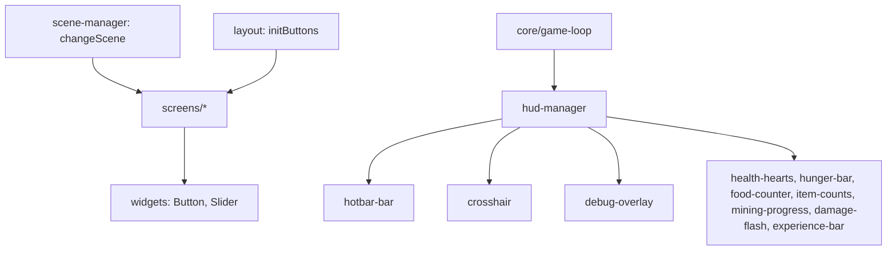

# ui

## Descripción y objetivo
Interfaz de usuario: gestor de escenas, orquestación de menús, widgets, pantallas y HUD. Se dibuja sobre el canvas 2D.

## Archivos y subcarpetas
| Ruta | Función |
|---|---|
| `scene-manager.js` | Provee `drawScreens`, `screen`, `previousScreen`, `changeScene`, `play`, `clear`, `dirt`. Controla escenas y transiciones. |
| `layout.js` | Provee `initEverything`, `initButtons`. Orquesta la inicialización de los botones de todos los menús. |
| `widgets/` | `button.js` (`Button`) y `slider.js` (`Slider`, `mouseS`): componentes interactivos. |
| `screens/` | Una pantalla por archivo: `main-menu`, `options-menu`, `world-select`, `world-create`, `world-edit`, `pause-menu`, `loading-screen`, `death-screen`, `inventory-screen`, `placeholder-screens` (menús provisionales). |
| `hud/` | `hud-manager` (`HUD`, `hud`), `hotbar-bar`, `crosshair`, `debug-overlay`, `experience-bar`, y los componentes de supervivencia `health-hearts`, `hunger-bar`, `food-counter`, `item-counts`, `mining-progress`, `damage-flash`; `_legacy-survival-hud.js` (`survivalHUD`, versión legacy). |

## Flujo

## Dependencias
- Casi todas las pantallas → `widgets/button`, `ui/scene-manager`.
- `world-select` y `world-edit` → `world/world-storage`. `death-screen` → `survival/death-respawn`.
- `inventory-screen` → `inventory/creative-inventory`.
- Componentes HUD de supervivencia → `hud-manager`, `survival-state`.
- `hotbar-bar` → `inventory-state`, `render/block-icons`.

## Referencias
- [`render`](../render/README_render.md) (`canvas2d`), [`world`](../world/README_world.md), [`gamemodes`](../gamemodes/README_gamemodes.md), [`inventory`](../inventory/README_inventory.md), [`core`](../core/README_core.md).