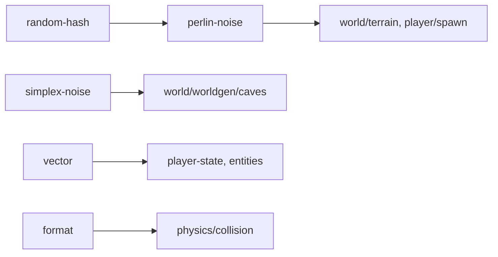

# utils

## Descripción y objetivo
Utilidades matemáticas reutilizables: vectores, formato numérico, azar con semilla y ruido para la generación del mundo.

## Archivos
| Archivo | Provee | Función |
|---|---|---|
| `vector.js` | `PVector` | Vector 3D (`set`, `normalize`, `add`, `mult`). |
| `format.js` | `timeString`, `roundBits` | Formato de tiempo y redondeo numérico. |
| `random-hash.js` | `seedHash`, `hash`, `worldSeed`, `Marsaglia`, `randomSeed`, `random` | Generador pseudoaleatorio con semilla y hashing. |
| `perlin-noise.js` | `PerlinNoise`, `noise`, `noiseSeed`, `noiseProfile` | Ruido Perlin 1D/2D/3D con octavas. |
| `simplex-noise.js` | `openSimplexNoise`, `caveNoise` | OpenSimplex 3D, usado para cuevas. |

## Flujo

## Dependencias
- `perlin-noise` → `random-hash`. Los demás → `core/environment`.

## Referencias
- [`world`](../world/README_world.md), [`player`](../player/README_player.md), [`entities`](../entities/README_entities.md), [`physics`](../physics/README_physics.md).