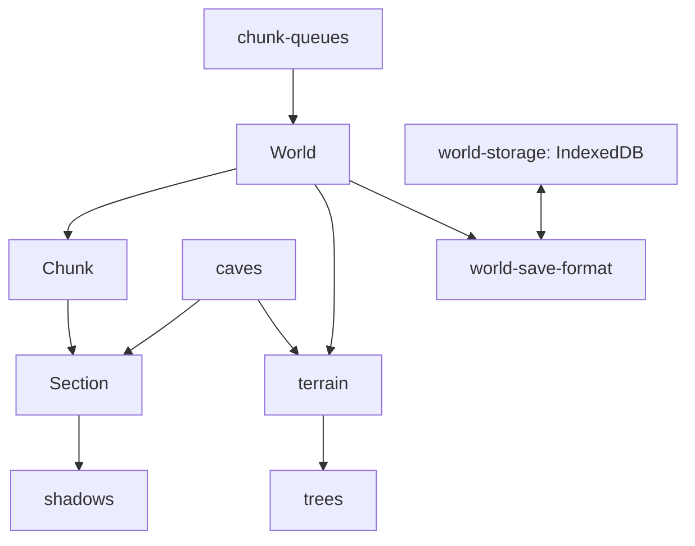

# world

## Descripción y objetivo
Representación del mundo: chunks, secciones, iluminación, generación procedural, guardado y carga.

## Archivos
| Archivo | Provee | Función |
|---|---|---|
| `world.js` | `World`, `fogDist` | Clase principal: bloques y ciclo de vida de chunks. |
| `chunk.js` | `Chunk` | Columna de 16×256×16 formada por secciones; pipeline de generación. |
| `section.js` | `Section`, `emptySection`, `fullSection` | Subchunk de 16×16×16 y optimización de malla. |
| `shadows.js` | `getBlock`, `hideFace`, `getShadows`, `interpolateShadows`, `renderedChunks` | Oclusión de caras y sombra suave por vértice. |
| `chunk-queues.js` | `chunkDist`, `sortChunks`, `fillReqs`, `maxDist`, `renderFilter` | Distancia, ordenación y filtrado de colas de chunks. |
| `world-save-format.js` | `World.prototype.getSaveString/loadSave/loadOldSave` | Serialización y carga. |
| `world-storage.js` | `createDatabase`, `loadFromDB`, `saveToDB`, `deleteFromDB`, `save` | Persistencia en IndexedDB. |
| `worldgen/terrain.js` | `Chunk.prototype.genTerrain`, `World.prototype.genChunk` | Superficie y alturas por columna. |
| `worldgen/trees.js` | `Chunk.prototype.populate` | Árboles y vetas de mineral. |
| `worldgen/caves.js` | `sphere`, `isCave`, `carveSphere` | Cuevas por ruido y talla esférica. |

## Flujo

## Dependencias
- `section` → `shadows`, `caves`, `core/constants`, `blocks/block-registry`.
- `chunk` → `section`, `perlin-noise`, `random-hash`. `world` → `chunk`, `chunk-queues`, `core/analytics`.
- `terrain` → `world`, `chunk`, `caves`. `trees` → `chunk`, `terrain`, `random-hash`.
- `caves` → `simplex-noise`, `block-registry`. `world-storage` → `core/environment`.

## Referencias
- [`utils`](README_utils.md), [`blocks`](README_blocks.md), [`render`](README_render.md) (`defineWorld`), [`ui`](README_ui.md) (`world-select`, `world-create`), [`interaction`](README_interaction.md).